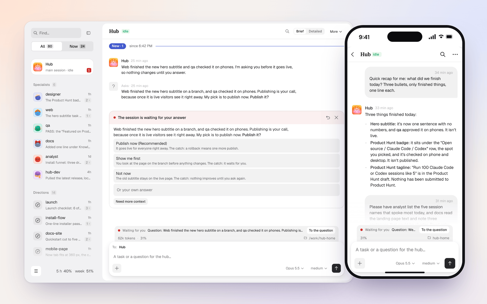
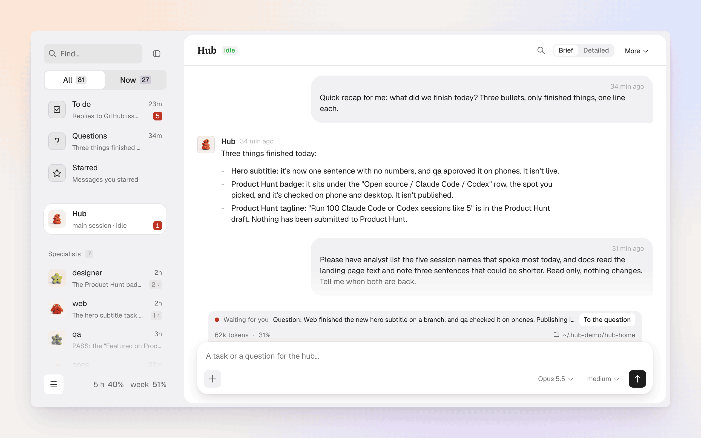
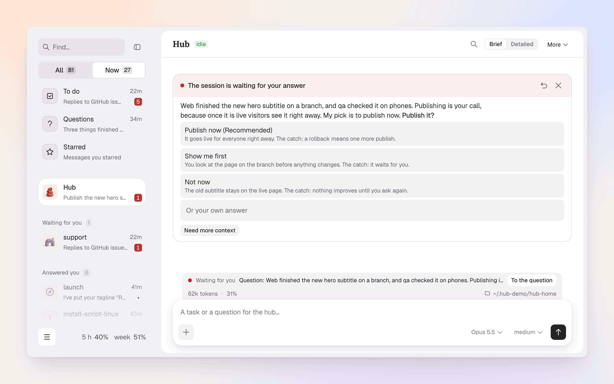
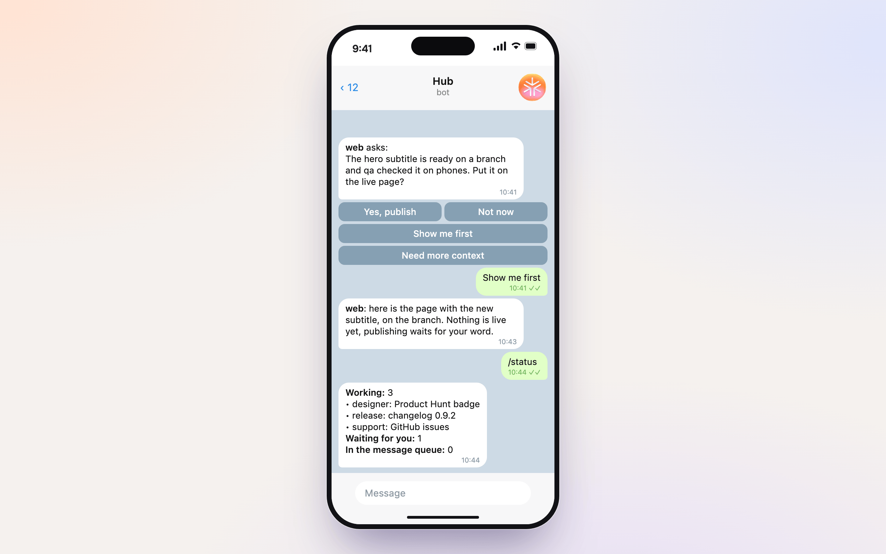
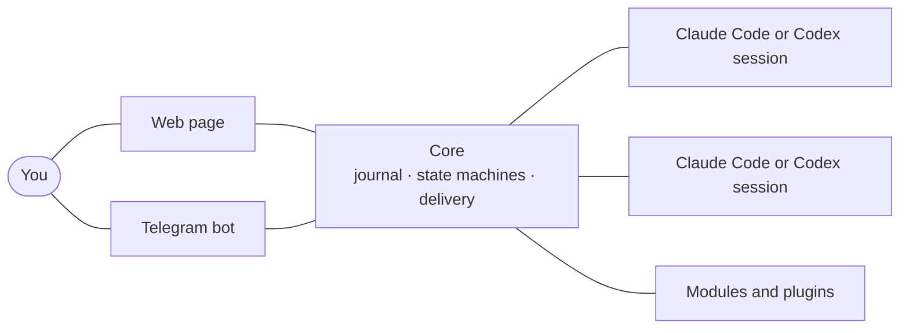

<h1 align="center">&nbsp;Hub by Icons8</h1>

<p align="center">
  <b>Run 100 Claude Code or Codex sessions like 5.</b><br>
  The hub keeps them in order, hands the work out and brings you only the decisions, in your browser or in Telegram.
</p>

<p align="center">
  
  
  
</p>

<p align="center">
  <a href="#quick-start"><b>Quick start</b></a> ·
  <a href="#why-a-hub">Why</a> ·
  <a href="#what-you-get">Features</a> ·
  <a href="#how-it-works">How it works</a> ·
  <a href="#faq">FAQ</a> ·
  <a href="SECURITY.md">Security</a> ·
  <a href="CHANGES.md">Changelog</a>
</p>

<p align="center">
  
</p>

> **Experimental, and honest about it.** The hub drives [Claude Code](https://claude.com/claude-code) or
> [Codex](https://github.com/openai/codex) sessions (it brings its own copy of the program; you sign in to your Claude
> account, or to Codex) with no prompt per action, so treat it like a shell on your machine. It runs on your computer or your own
> server, and nothing is sent anywhere you did not turn on. Not affiliated with Anthropic. Read [SECURITY.md](SECURITY.md) before you run it anywhere that matters.

## Quick start

The usual way is one line in a terminal:

```sh
curl -fsSL https://icons8.github.io/hub/install.sh | bash     # macOS 13.5+, Linux (glibc 2.28+)
irm https://icons8.github.io/hub/install.ps1 | iex             # Windows 10/11, in PowerShell
```

A team's own build has its own line, with the team's build key in it: take that whole line from your team's chat.

Nothing has to be installed first and no administrator rights are needed: the line puts the hub's own environment
(Python, Node, gh, ffmpeg; git too on macOS and Windows; on Linux a missing git is installed through the
system's package manager, with `sudo`), the hub's code, its service and the `hub` command into your
user folder, then opens the page. The hub installs Claude Code and a browser for agents itself; what is left for you is
"Sign in to Claude" on the band above the page. To work on Codex instead, choose "Sign in to Codex" there: the hub
restarts on Codex and installs its CLI by itself ([Codex](#codex)). See [One path](#one-path) for updates and your own edits.

Or ask your agent to do it. Open Claude Code or Codex in any folder and paste:

```text
Install Hub by Icons8 for me with its one-line installer. On macOS or Linux run:
curl -fsSL https://icons8.github.io/hub/install.sh | bash. On Windows, in PowerShell, run:
irm https://icons8.github.io/hub/install.ps1 | iex. Do not clone the repository and do not run it as root.
If the command times out, run it again: it continues. When it finishes, open http://127.0.0.1:8787/ and
check that the page answers.
```

Then open the page and write the hub a task in plain words. Telegram, voice and phone access turn on when you need them.

### On a cloud server

To try the hub away from your own computer, give it a virtual machine: Ubuntu 22.04 or 24.04, or Debian 12 or 13,
x86_64 (Ubuntu on arm64 works too, without Chrome for the agents), 8 GB of memory (3.5 GB at least), 20 GB of disk, your SSH key. When you create it, paste this into its "user data"
field:

```sh
#!/bin/bash
curl -fsSL https://icons8.github.io/hub/install.sh | bash -s -- --server --yes
```

| Cloud | Where the field is | Tested |
|---|---|---|
| Hetzner Cloud | Create server → Cloud config | Ubuntu 24.04 x86_64, Debian 12 x86_64, Ubuntu 22.04 arm64 |
| DigitalOcean | Create Droplet → Advanced options → Add initialization scripts | Ubuntu 24.04 and Debian 13, x86_64 |
| AWS EC2 | Launch instance → Advanced details → User data | Ubuntu 24.04 x86_64, Ubuntu 22.04 arm64, Debian 12 x86_64 |
| AWS Lightsail | Create instance → Add launch script | not yet |
| Azure | Create a virtual machine → Advanced → Custom data | not yet |
| Google Cloud | Create instance → Advanced → Metadata, key `user-data` (not `startup-script`, which runs at every boot) | not yet |

"Tested" means the line ran from that field on a new machine, the page answered through the SSH tunnel, and it
answered again after a reboot with nobody signed in.

A machine that is already running takes the same line by SSH, as root or as a user with `sudo` without a password
(`curl -fsSL … | bash -s -- --server`); a team's own build — its own line with `-s -- --server` added. The line makes a user `hub` without a password and without `sudo` (the hub's
sessions run without asking, so they must not get root), installs git, Google Chrome for the agents (x86_64) and a swap
file on a small machine, lets the hub start with the machine, and installs the hub under that user as above.

Nothing of the hub listens on the server's public address: its page is on `127.0.0.1` (and on its tailnet address,
if you connect the server to Tailscale and turn Tailscale access on — see [Security](#security)). Bring it to your computer with SSH, keep
the command running and open http://localhost:8787 there; the command is printed at the end of the install and every
time you sign in to the server by SSH:

```sh
ssh -N -L 8787:127.0.0.1:8787 -L 8788:127.0.0.1:8788 hub@<server address>
```

On the page, "Sign in to Claude" (or "Sign in to Codex") gives a link and a field for the code. From a phone, use the hub's Telegram bot
(`sudo -iu hub hub-telegram token` on the server), or your own domain in Cloudflare (`hub remote cloudflare setup`).

The cloud can read the machine's disk and its snapshots, the Claude sign-in included: before you delete the machine,
run `sudo -iu hub claude auth logout`. Deleting the machine removes everything; to keep the machine and remove the hub,
run the line again with `--server --remove` (it takes off only what `--server` put on: the user `hub` with its home
folder, the swap file, the login message; the packages stay).

## One path

Every hub is installed by the one line and updated by its packages; a git clone of the core is only for the people who
write the core. The full Hub Developer, the session that changes the hub's code for you and sends fixes, works the
same on a hub from the line.

- **Updates** come in the background, on one channel: every 6 hours the hub looks for a new version, downloads it,
  checks its sum and its file list and puts it next to the running one, then asks you to restart ("Restart" on the page
  and in Telegram; not pressed — it starts at the next restart). If the hub does not come up on it within 3 minutes, the
  watchdog of the previous version puts that one back. A team's build also reports the failed update to its developers:
  "About the hub" (Settings → About) says what goes and has the switch (`update.report: false`).
- **Your settings, plugins and own modules** survive every update with no work.
- **The core's code**: the Hub Developer edits it in a working copy in the state folder, `~/.hub-core/own/core`
  (`hub app src`) — a git clone of your release's commit when the machine has access to the repository (with the
  tests), else the release's own files without tests. Your edits are commits of its branch `local`; `hub app apply`
  builds the hub's code of them with the release's own factory and asks you to restart. A build that does not come up
  goes back to the clean release by itself; "Return the released" in "About the hub" takes the edits off.
- **An update** installs the clean release: your edits stay in the working copy and are not carried over by
  themselves. Need them still — ask the Hub Developer to put them back or to make a pull request of them (with access
  to the repository; without it, it files an issue).
- **A hub from git** keeps working as it did. The line run on its machine asks whether to move it (sessions, journal,
  settings, plugins and own modules stay); `hub app undo` puts it back on its clone within 14 days. With no terminal to
  ask in, the line changes nothing there and exits with code 3, naming `--move` and `--stay`
  (`curl … | bash -s -- --move`).

## Why a hub

One Claude Code or Codex session is a chat. Ten of them are a mess: which one is stuck, which one waits for you, who told whom
what. The hub is the dispatcher. It keeps sessions alive, delivers messages to them, brings you their questions and
results, and remembers tasks.

What it is not:

- **Not a sandbox.** Sessions run with the tools you give them. The hub adds order, not walls ([SECURITY.md](SECURITY.md)).
- **Not a replacement for Claude Code or Codex.** Every session is a real Claude Code (or Codex) process that you could open yourself.
- **Not a cloud service.** The hub runs on your computer or on your own server, and your code and credentials stay there. The one shared piece is the optional relay that lets hubs talk to each other: it passes their messages without seeing the text, and you can run your own.

## What you get

**A team, not a chat.** You talk to one coordinator session in plain words. It decides who does what, starts the right
session and brings the result back. Permanent *agents* have their own area, tools and notes; short-lived *executors*
work on one task in their own git worktree, report, and go to sleep with their conversation intact.

<p align="center">
  
</p>

**One feed, with what needs you on top.** Every session in one list; the *Now* tab shows only what waits for you, what
is new, what is working. A question from a session arrives as a card with buttons, on the page and in Telegram.

<p align="center">
  
</p>

**Your phone is a full client.** Telegram brings results and questions to your chat; a reply goes to the session that
asked. Questions come with buttons, `/status` shows who works on what. The page itself works on a phone, and reaches it
through your Tailscale network without opening any port.

<p align="center">
  
</p>

**Messages arrive, in order.** A message to a busy session waits for the end of its turn and is not lost; an urgent one
("stop, don't touch production") gets through in the middle of a turn. You see whether it was delivered.

**It watches itself.** An event journal is the single source of truth and the state is a pure function of it. A watchdog
notices loops, silent sessions and sessions that repeat the same error. A restart waits until everyone is free, and a
session that fell is started again with its conversation.

**Extend it without touching the code.** Skill sets, MCP servers, your own processes, tabs on the page and themes live in
your own folder and do not conflict with updates ([EXTENDING.md](EXTENDING.md)).

**Secrets agents use without seeing them.** Settings → Secrets keeps passwords and API keys sealed (AES-256-GCM, the key
outside the hub's folder: Keychain, DPAPI, or a file in the settings folder on Linux). An agent puts one into a login
field or a command with `hub secret fill` / `hub secret exec` and never sees the value; every use is a line in the
feed. On for every hub (`secrets.enabled: false` turns it off); it guards against leaks by accident, not against a
session set on getting a value.

**One hub or several.** Settings → General → Hubs on this computer adds another hub beside this
one, with its own folders, service and page (`hub instance new <name>`), and each hub can have its own password and its
own engine, Claude Code or Codex ([below](#codex)). Hubs of different people can be linked by an invitation (Settings → External hubs) so their
agents write to each other, encrypted; it is off until you make or accept one. A hub installed by the line above links
through the public relay its install names, with nothing to set: the relay sees which hub writes to which and when,
never the text. A hub from git pastes that relay's line from [v1/relay.json](https://icons8.github.io/hub/v1/relay.json)
into "Accept an invitation". Your own relay instead: one command on your server ([relay/README.md](relay/README.md)),
its line pasted there before the first link.

More: files of your projects in the browser, a scheduler for recurring jobs, voice input, a separate browser per session,
an "I am away" mode with a summary when you are back, a catalog of tools with a risk label on each, a "Usage" page in
the ☰ menu (Claude limits with a forecast, what the sessions spent), and Settings → Look for the page's theme and text
size.

### Codex

Codex is the hub's second engine, on a par with Claude Code. The engine is a setting of the whole hub: every session of
a hub, the coordinator and the executors included, runs on one of them. Choose it:

- on the band above the page of a new hub: "Sign in to Codex" instead of "Sign in to Claude" (the hub restarts on Codex
  and installs the Codex CLI from OpenAI's releases when the computer has none; `hub setup codex` does only that);
- for a second hub: "Add a hub" → "Engine: Codex" on the page, or `hub instance new <name> --engine codex`.

The hub keeps Codex in its own folder: its sign-in (a code you enter from any device, `hub codex login`), settings and
conversations are not your personal `~/.codex`, and your rules, MCP servers and memory from there do not reach a hub
session. Settings → Codex holds that sign-in.

It works the same as on Claude Code: the feed, cards with buttons on the page and in Telegram, delivery with a mid-turn
insert, tasks, executors in their own worktrees, the schedule, the watchdog, restarts that bring sessions back with their
conversation, MCP servers and their sign-in, skills from the catalog and from the repository, a repository's hooks and
bans, the bus liaison between hubs, voice reply, and the "Usage" page with Codex limits and spend in tokens.

What differs, briefly:

- Models are named `codex/<id>`, and an effort the model does not have is lowered to the strongest it has; `/compact`
  takes no instructions on Codex, and a conversation does not move between the engines.
- Sessions run in `bypassPermissions` mode like on Claude Code (Codex: never ask, no sandbox); the other modes map to
  Codex's approval policy and sandbox. On Windows the modes that need Codex's sandbox set it up by themselves, and a
  session that cannot get it does not start.
- Claude-only things are absent on a Codex hub: the Claude sign-in and Claude's model names.
- The texts of the sessions, and the hub's own short model calls (the watchdog's "does it wait for you", push texts),
  go to OpenAI.

## How it works



- **The journal.** Everything that happens is a line in the event journal. The state is a pure function of it
  (`core/reducer.py`), transitions are state machines (`core/machines.py`).
- **The core** (`bin/hubd`) is the only writer of the journal. The page, the bot, the CLI and the hooks only send facts to
  its mailbox; the core records them and tells the host what to do.
- **The host** (`hosts/streamjson.py`) starts one `claude -p` process per session in stream-json mode; on a hub that
  runs on Codex, `hosts/codex.py` talks to `codex app-server` instead, and the core's facts are the same.
- **Modules** (`modules/`) sit on top of the core: the page, Telegram, the scheduler, files, the watchdog, updates and
  more. The model only reports facts, the hooks only record events, and only the core decides.

Every known failure became a replay test: a recorded sequence of events that no longer breaks. The suite has about twelve
thousand tests (`tools/test.py`); every release is tested on Windows too, and on the Claude Code version it names, which
the hub downloads by itself.

## Security

Short version; the full text, with what the hub does **not** protect, is in [SECURITY.md](SECURITY.md).

> **The page and "Files" have no sign-in unless you set a password.** Without one, anyone else who can open
> `127.0.0.1:8787` on the same machine (another user, a container next to the hub) acts as the operator, and "Files"
> shows them the whole disk as the hub's user. Install the hub only on a machine where you are the only user, or set a
> password for every hub of the machine: Settings → General → Hubs on this computer, "Password" (off by default).

| | |
|---|---|
| **What runs** | Claude Code (or Codex) sessions as your OS user, in `bypassPermissions` mode (on Codex: never ask, no sandbox): no prompt per action. |
| **What the hub adds** | Risky tools (money, production, your data, outgoing messages) connect only after your yes; only your words count as the operator's; secrets are masked in the journal; the hub's folders are readable only by you. |
| **Who reaches the page** | This machine (`127.0.0.1`). The devices of this machine's Tailscale login only once you turn Tailscale access on (Settings → Modules → Tailscale; `"tailnet": {"enabled": false}` in `hub.json` turns it back off). Your Cloudflare Tunnel only when you set it up. |
| **What leaves the machine** | What Claude Code sends to Anthropic as usual (on a Codex hub: what Codex sends to OpenAI); the update check (a hub from the line: the project's GitHub Pages and release files; from git: `git fetch` from its source); the plugin catalogs the hub connects by itself, read from GitHub once a day: the project's own catalog, `anthropics/claude-plugins-official` and `openai/plugins`; the downloads of Claude Code and the agents' Chrome when the hub installs them, and of the browser's MCP server from npm when it runs through `npx`; what you turn on yourself (Telegram, the hub bus, Cloudflare remote access, voice). No telemetry unless you switch it on. |
| **What it does not do** | Isolate sessions from each other or from your files; stop a session that was talked into something by text it read. |
| **Safer setup** | A virtual machine or container with only the repositories the work needs, a separate OS user, no administrator credentials. |

## Installation and configuration

<details>
<summary><b>macOS, Linux, Windows, and the settings you will want</b></summary>

This is for a hub run from a clone of the core ([Working on the core](#working-on-the-core)); a hub from the line needs
none of it ([One path](#one-path)). You need Python 3.12 or newer and git; the clone's `origin` is also the update source.

- **macOS:** `deploy/mac/install.sh`: a launchd agent, state in `~/.hub-core`, settings in `~/.config/hub-core/hub.json`.
  The installer finds a suitable Python or offers to install one with Homebrew, puts `hub` and `hub-telegram` in
  `~/.local/bin` and starts the hub through `Agents Hub.app`, so macOS asks for access to protected folders once, for it.
  The open release's launcher, `Hub by Icons8.app`, is signed ad hoc: macOS ties that access to the launcher's build, so
  after an update that brings a new launcher it asks once more.
- **Linux:** `sh deploy/install.sh` needs no root. It finds Python (or tells you how to install it), offers to download
  Claude Code into the hub's own folder when the machine has none, writes the settings to `~/.config/hub-core/hub.json`, and runs the hub as one systemd user service `agents-hub`. On a
  server without a login session run `sudo loginctl enable-linger <user>` once.
- **Windows:** `powershell -ExecutionPolicy Bypass -File deploy\windows\install.ps1` needs no administrator rights.
  Settings go to `%APPDATA%\hub-core\hub.json`, state to `%LOCALAPPDATA%\hub-core`, and the hub starts at sign-in as the
  scheduled task "Agents Hub".
- **By hand:** `bin/hub-up`; the page is at http://127.0.0.1:8787/.

Control the service with `hub off` and `hub on`, open the page with `hub ui`, check the setup with `hub doctor`, restart with
`hub restart`. The coordinator session is enabled by the installers; when you start by hand without them, add it to
`hub.json` and restart:

```json
"hub": {"enabled": true, "name": "hub-core", "cwd": "<state folder>/hub-home"}
```

Optional features are switched on in settings: Telegram (create a bot with @BotFather; enter its token in a terminal on the
machine that runs the hub, not in the chat with the hub: `hub-telegram token`, paste the token, Enter; then send `/start`
to the bot and run `hub-telegram pair <code>`; for a team, `/start` in a group instead: its admins speak for the owner,
other members only ask, `/here <session>` gives a topic to a session), voice (Settings → Modules → Voice: a built-in recognition model chosen for the hub's language, or your own recognition command in `voice.cmd`), the watchdog (`watch.json` with a model key).
Tailscale access (Settings → Modules → Tailscale, or `"tailnet": {"enabled": true}`): the page and "Files" also listen
on the machine's tailnet address for the devices of its Tailscale login (`tailnet.owners` names other logins;
`"tailnet": {"enabled": false}` turns it back off). A hub that updates from a release without this switch keeps it on if Tailscale worked there at the update; if Tailscale
is installed but not connected then, this is decided when it connects; without Tailscale then, it stays off until you turn it on.

Environment variables from your Claude Code settings do not reach hub sessions, except sign-in and proxy. If your MCP
servers need tokens, list their names in `hub.json` (`"user_env": ["SERVICE_TOKEN"]`); the values are taken from your
Claude Code settings and go to every session of the hub.

To set a variable with its value for hub sessions only, put it in `hub.json`:
`"session_env_values": {"CLAUDE_CODE_SUBAGENT_MODEL": "sonnet"}`. Only `CLAUDE_CODE_SUBAGENT_MODEL` is accepted (other
names are skipped with a line in the log, so secrets do not travel through hub.json); the value wins over the same name
brought by `user_env`, and a core module that sets the variable at session launch (`launch.env`) may override it. It
applies from a session's next start.

Reasoning effort is `"effort"` in `hub.json` (`low`, `medium` by default, `high`, `xhigh`, `max`); for one session
`hub session effort <session> high`. The model is `"model"` in `hub.json`, for one session `hub session model <session>
opus|sonnet|haiku` or a full model id.

On Windows, schedule command jobs (`hub schedule add --command`) and the pre-checks of session jobs run in cmd.exe. With
`"schedule": {"shell": "bash"}` in `hub.json` they run in Git Bash (the one `CLAUDE_CODE_GIT_BASH_PATH` names, or
`bash.exe` in the `bin` folder next to `git`), with `hub` in `PATH`: write them as in Bash, with pipes, `$(...)` and single quotes. If
Git Bash is not found, they stay in cmd.exe with a line in the log. On macOS and Linux the setting changes nothing.

A `.deb` package with its own environment inside (Python, Node, gh, ffmpeg) is built by `tools/package/deb/build.sh`;
the parts of the app installers for every OS — by `tools/package/build.py <platform>`.

</details>

## Uninstall

`hub uninstall`, run in a terminal (not from a session), takes the hub off the machine the way its installer put it on:
it stops the hub (and waits until it has stopped), removes its service — the launchd agent `com.hub-core` on macOS, the
systemd user unit `agents-hub` on Linux, the scheduled task "Agents Hub" and its folder in your `PATH` on Windows — and the
`hub` and `hub-telegram` commands in `~/.local/bin` that lead to this hub. It shows the plan and asks before it starts;
`--dry-run` only shows it.

Your data stays: the state folder (`~/.hub-core`, on Windows `%LOCALAPPDATA%\hub-core`: the journal, the conversations of
sessions, the schedule) and the settings (`~/.config/hub-core`, on Windows `%APPDATA%\hub-core`), so a later install
carries on from them. `hub uninstall --purge` deletes them too, after you type the state folder's name (`--yes` skips both
questions); it refuses a folder that does not look like a hub's.

Never touched: Claude Code and its sign-in, Python, and the clone itself — delete the clone by hand afterwards.

- **macOS:** the line the installer may have added to `~/.zshrc` (or your bash login file) to put `~/.local/bin` in `PATH`
  stays; it is marked `# hub-core: ~/.local/bin`. A second hub installed with `HUB_INSTANCE=<name>` is removed with its own
  command, `hub-<name> uninstall`. The downloaded app goes to the Trash as usual.
- **Linux:** if you enabled lingering for the hub, it stays on: `sudo loginctl disable-linger <user>`.
- **Windows:** `powershell -ExecutionPolicy Bypass -File deploy\windows\uninstall.ps1 [-Purge] [-Yes] [-DryRun]` runs the
  same `hub uninstall` and also works in a window where `hub` is not on `PATH` yet; use it for `-Purge`, since the `hub`
  command itself lives in the folder that `-Purge` deletes.

To check a clean install and removal on a throwaway machine: `sh deploy/smoke.sh` (Linux; a temporary home folder, the
machine's own hub is not touched; `--here` uses the real home and service manager — on macOS only this way) and
`powershell -ExecutionPolicy Bypass -File deploy\smoke.ps1` (Windows, only where no hub is installed). Each installs the
hub, waits for the page and `hub status`, uninstalls it with `--purge` and checks that nothing is left.

## Extend

Skill sets (Claude Code marketplaces), MCP servers, hub modules (Module API), page plugins and themes live outside the
code of the hub and survive updates. Start with [EXTENDING.md](EXTENDING.md). A hub from the line updates by its
packages ([One path](#one-path)): it does not run the tests on your machine, a release has passed them before it comes
out, and `update.manual: true` makes it install only on "Update". A hub from git updates itself too: it follows `main`
(nightly), everything new at once; the merge and the tests run in a separate copy first (`update.enabled: false` turns
updates off).

## FAQ

**Do I need a Claude subscription?** The hub starts Claude Code with its own copy (the one `claude` in your terminal is
not touched), so you only sign in to your Claude account on the band above the page; on a hub running on Codex, to
Codex (with a ChatGPT account, by a code). The hub does not give you access to a model.

**Where do my data go?** Nowhere except where Claude Code already sends them (Anthropic's API; on a Codex hub — OpenAI) and where you point the
hub: a Telegram bot, a git remote, the relay of hubs you linked (it carries their messages sealed, without the text).
There is no other hosted part, and no usage reporting unless you switch one on. The one
exception is a team's one-line build: an update that fails sends its developers a report, on unless you turn it off —
the versions, the step, the error with its paths, the update's logs, the free space, the plugins and modules, the
machine's and the user's names and the hub's id; no texts of sessions, no journal, no settings. "About the hub"
(Settings → About) lists what goes and has the switch.

**Does it run on Windows?** Yes, with its own installer and a scheduled task; every release is tested on Windows too.

**Can I use it without Telegram?** Yes. Telegram is optional; the page is the main way in and works on a phone.

**How do I remove it?** `hub uninstall` (with `--purge` for the data too), then delete the clone; see
[Uninstall](#uninstall).

**Why did a database or server I started from a session stop when the session ended?** On macOS and Linux every process a
session starts carries the marker `HUB_TREE=<session>@<hub>`. When the session goes away for good (an executor hands in its
work, the session is removed, `hub stop`), the hub sends SIGTERM to all processes with its marker, then SIGKILL; parking a
session and `hub restart` do not touch them. A daemon that must outlive the session (a container VM such as colima/limactl,
a database used by other sessions) should not carry the marker: start it as `env -u HUB_TREE <command>`, or from the system
service manager (launchd, systemd). On Windows the session's processes end with it, and `env -u` does not exist there.

**Is it safe to point at my work repositories?** It is as safe as running Claude Code (or Codex) with no approvals there:
the hub does not change that. Read [SECURITY.md](SECURITY.md) and prefer a disposable machine for anything valuable.

## Contributing, community, license

- **Pull requests are not accepted for now**, a deliberate decision of a small team; see [CONTRIBUTING.md](CONTRIBUTING.md)
  for what helps instead: bug reports, ideas in Discussions, and your own modules and plugins.
- Found a vulnerability? Report it privately through GitHub, not in a public issue ([SECURITY.md](SECURITY.md)).
- Be kind: [Code of Conduct](CODE_OF_CONDUCT.md).
- Licensed under the Apache License 2.0: see [LICENSE](LICENSE) and [NOTICE](NOTICE).
  Bundled third-party libraries and fonts keep their own licenses: see [THIRD-PARTY-NOTICES.md](THIRD-PARTY-NOTICES.md).

### Working on the core

To run the core from a clone and live on `main`:

```sh
git clone https://github.com/icons8/hub.git agents-hub && cd agents-hub && sh deploy/install.sh
```

On macOS use `deploy/mac/install.sh`, on Windows `deploy\windows\install.ps1` (details
[above](#installation-and-configuration)). Such a hub lives on `main` (nightly), and you make your edits and pull
requests right in the clone. Pull requests from outside the team are not accepted for now (see the first point above).

## Contributors

Created by Pavel Malai ([@flagman](https://github.com/flagman))

With the pull requests, bug reports and ideas of (most first; the whole list with what it counts is in
[CONTRIBUTORS.md](CONTRIBUTORS.md)):

- [@visualpharm](https://github.com/visualpharm): 164 pull requests, 1 report or idea
- [@kalimullin](https://github.com/kalimullin): 61 pull requests, 4 reports and ideas
- [@ManyLattice](https://github.com/ManyLattice): 56 pull requests, 5 reports and ideas
- [@Eugenius-S](https://github.com/Eugenius-S): 58 pull requests
- [@Serjiios](https://github.com/Serjiios): 45 pull requests, 3 reports and ideas
- [@eniwito](https://github.com/eniwito): 34 pull requests, 1 report or idea
- [@tolaysha](https://github.com/tolaysha): 18 pull requests
- [@Scremliss](https://github.com/Scremliss): 16 pull requests
- [@GreatMedivack](https://github.com/GreatMedivack): 4 pull requests, 9 reports and ideas
- [@dnnaumov99](https://github.com/dnnaumov99): 11 pull requests
- [@Enwimo](https://github.com/Enwimo): 10 pull requests, 1 report or idea
- [@elenalo91](https://github.com/elenalo91): 8 pull requests
- [@libertyswift](https://github.com/libertyswift): 6 pull requests
- [@sanchopanda](https://github.com/sanchopanda): 5 pull requests
- [@Hunter3301](https://github.com/Hunter3301): 5 reports and ideas
- [@gevvos](https://github.com/gevvos): 3 pull requests, 1 report or idea
- [@summers-julia](https://github.com/summers-julia): 1 pull request, 3 reports and ideas
